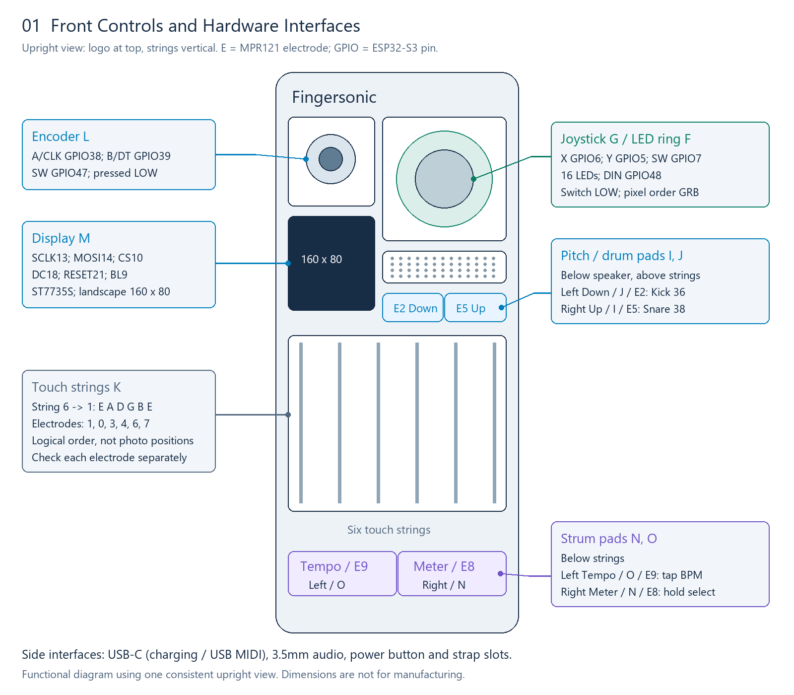
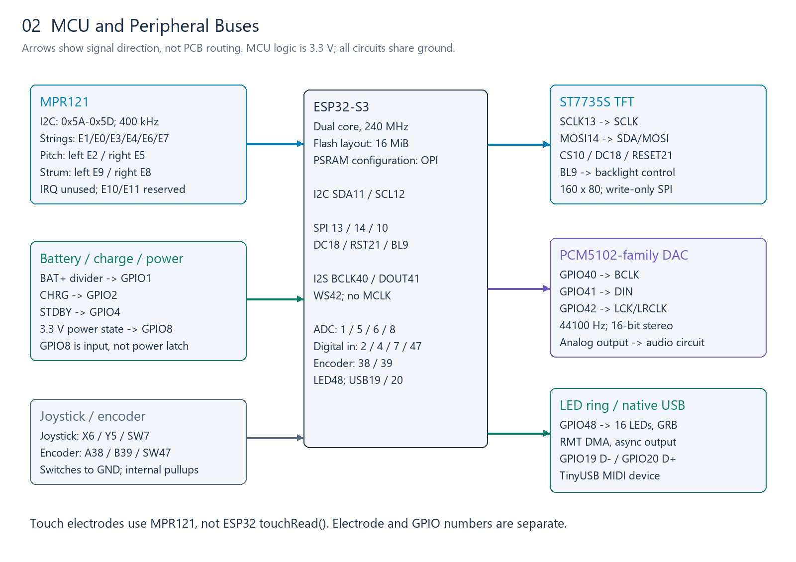
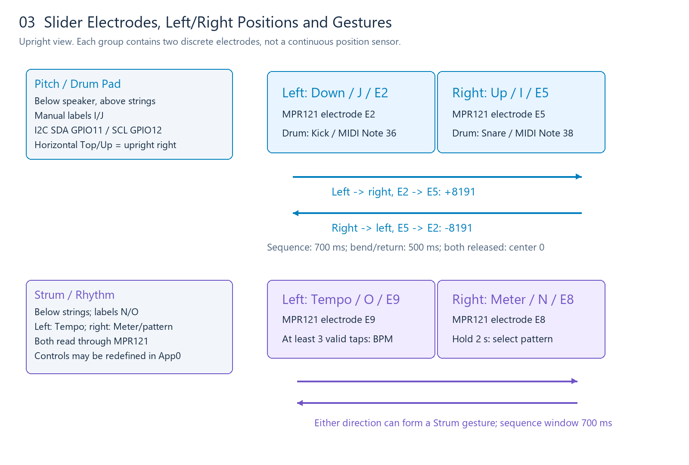
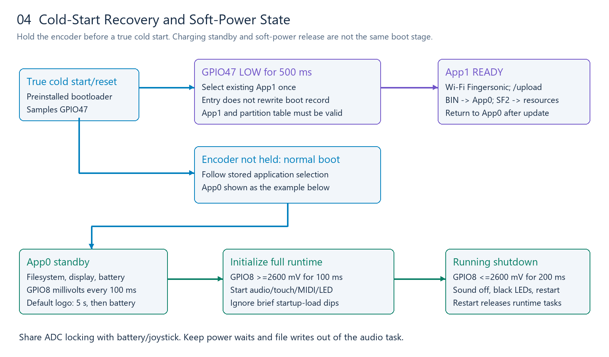
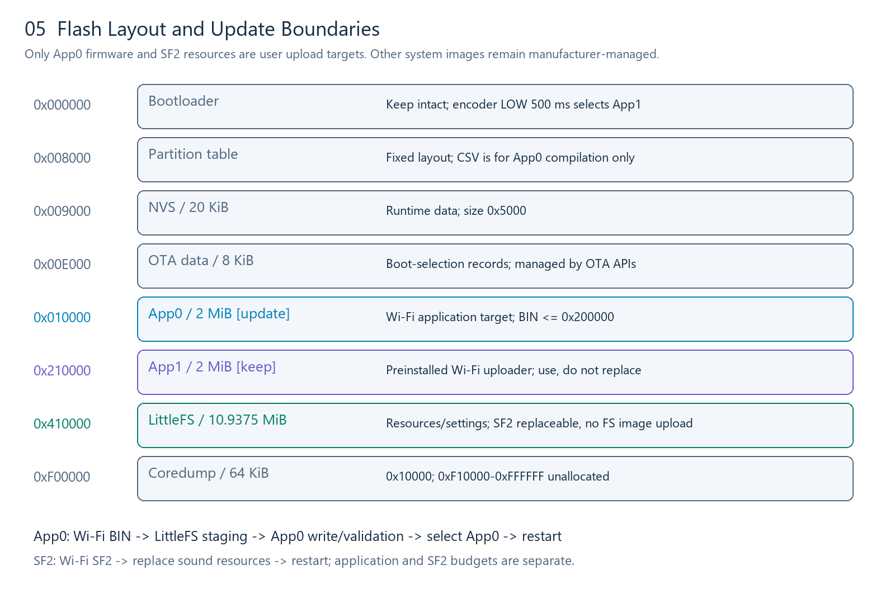

# Fingersonic Hardware Interfaces and Third-Party Firmware Guide

Document version: 2.0 · Updated: 2026-10-13 · Hardware: single ESP32-S3 with ST7735S color display

Turn Fingersonic into a groovebox, synthesizer, sampler, music player, MIDI controller or wireless remote. Third-party App0 firmware can redefine the six touch strings, two dual-electrode slider groups, joystick, encoder, LED ring and display.

**User firmware updates are limited to App0. Users may also replace the SF2 sound bank. Both uploads use the preinstalled App1 Wi-Fi uploader.** App1, the bootloader, partition table and system configuration remain manufacturer-managed. Development does not require the manufacturer's private firmware source; this package describes hardware interfaces, public libraries, recommended application design and optional communication protocols.

## Contents

- [1. Development boundary](#1-development-boundary)
- [2. Controls and orientation](#2-controls-and-orientation)
- [3. Chips and platform](#3-chips-and-platform)
- [4. Complete GPIO reference](#4-complete-gpio-reference)
- [5. Touch strings and slider groups](#5-touch-strings-and-slider-groups)
- [6. Touch reading, thresholds and calibration](#6-touch-reading-thresholds-and-calibration)
- [7. Battery voltage and charging status](#7-battery-voltage-and-charging-status)
- [8. Soft-power state](#8-soft-power-state)
- [9. DAC and I2S audio](#9-dac-and-i2s-audio)
- [10. Synthesizers, samplers and players](#10-synthesizers-samplers-and-players)
- [11. Joystick](#11-joystick) · [12. Encoder](#12-encoder) · [13. LED ring](#13-led-ring)
- [14. Display and refresh](#14-display-and-refresh)
- [15. USB and BLE MIDI](#15-usb-and-ble-midi)
- [16. Partitions and application size](#16-partitions-and-application-size)
- [17. Wi-Fi uploads and recovery](#17-wi-fi-uploads-and-recovery)
- [18. Arduino development](#18-arduino-development)
- [19. ESP-IDF development](#19-esp-idf-development)
- [20. Recommended libraries](#20-recommended-libraries)
- [21. Initialization and task scheduling](#21-initialization-and-task-scheduling)
- [22. Public API examples](#22-public-api-examples)
- [23. Troubleshooting](#23-troubleshooting)
- [24. Publishing third-party firmware](#24-publishing-third-party-firmware)
- [25. Project ideas](#25-project-ideas)
- [26. Optional app integration and chord symbols](#26-optional-app-integration-and-chord-symbols)
- [27. Support and contact](#27-support-and-contact)

## 1. Development boundary

| Target | User-facing operation |
|---|---|
| App0 | Develop an application, compile its BIN, and replace App0 through App1 Wi-Fi; use the same process to restore default App0 |
| App1 | Enter and use the preinstalled uploader; leave its firmware intact |
| Bootloader | Use the existing encoder cold-start recovery entry; leave its image intact |
| Partition table | Use the published layout for compilation; keep addresses, sizes and types unchanged |
| System boot records | Let the uploader and standard OTA APIs manage boot selection; do not erase or directly rewrite system areas |
| SF2 bank | Replace the sound resources by uploading an `.sf2` file through App1 Wi-Fi |
| Shared filesystem | App0 may use normal file APIs for application data; preserve other resources/settings and do not upload a filesystem image |

Musical features and app compatibility are optional. You can use your own audio engine, omit SF2 support, change the controls, or implement only part of the app protocol. Document the actual controls and recovery entry offered by your firmware. The preinstalled encoder cold-start entry remains available even when a third-party App0 cannot run.

## 2. Controls and orientation



All diagrams use the **upright front view: logo at the top, six strings vertical**. Leader endpoints identify the corresponding controls. Diagram dimensions are not manufacturing dimensions.

| Label | Control | Location/interface |
|---|---|---|
| F/G | LED ring and joystick | Upper right; LED GPIO48; joystick X6/Y5/SW7 |
| L | Encoder | Upper left; A38/B39/SW47 |
| M | Color display | Below the encoder; 160×80 landscape |
| H | Speaker area | Below the joystick; driven through the DAC and analog audio circuit |
| J/I | Pitch/drum pads | Below the speaker, above the strings; left J/E2, right I/E5 |
| K | Six touch strings | Six MPR121 electrodes |
| O/N | Strum pads | Below the strings; left Tempo O/E9, right Meter N/E8 |

Names such as TOP/BOTTOM and UP/DOWN originate from the horizontal orientation. In this upright view they correspond to right/left. Use the physical diagrams and electrode numbers when wiring or mapping controls. Each slider group contains **two discrete touch electrodes**, not a continuous position sensor.

## 3. Chips and platform

| Component | Interface/configuration |
|---|---|
| MCU | ESP32-S3, dual core; recommended application CPU frequency 240 MHz |
| Flash | 16 MiB layout; App0 occupies 2 MiB |
| PSRAM | OPI configuration; actual capacity depends on the installed module |
| Touch controller | MPR121, 12 electrodes; I2C address 0x5A–0x5D |
| Audio DAC | PCM5102-family interface; I2S input and analog output circuit |
| Display | 0.96-inch ST7735S; physical 80×160, application landscape 160×80 |
| LEDs | 16 WS2812-type RGB LEDs; GRB byte order |
| Inputs | Two-axis potentiometer joystick and incremental encoder, each with a push switch |
| Battery | Product-rated 1500 mAh; divider voltage sensing and two charging-status inputs |
| Communications | USB MIDI, BLE MIDI; Wi-Fi for App1 uploads |

The full module ordering code, actual PSRAM capacity and charger/amplifier/power-chip part numbers depend on the hardware revision. Software settings such as OPI and 16 MB do not specify the complete hardware bill of materials. Confirm the device revision before designing additional connections.



## 4. Complete GPIO reference

Directions are relative to the ESP32-S3. MCU inputs use 3.3 V logic. GPIO numbers are not connector pin positions. An unassigned signal is not automatically exposed or available for expansion.

| GPIO | Function | Mode/polarity | Notes |
|---:|---|---|---|
| 0 | Boot-strapping reserve | Keep existing wiring | Not a user control interface |
| 1 | Battery-divider ADC | ADC1, 12-bit, 11/12 dB attenuation | Calibrated sense millivolts ×3 |
| 2 | CHRG status | Digital INPUT | Interpret together with GPIO4 |
| 3 | Unassigned/boot-related | Do not initialize | Confirm hardware before expansion |
| 4 | STDBY status | Digital INPUT | Interpret together with GPIO2 |
| 5 | Joystick Y | ADC1 | Calibrate center and orientation |
| 6 | Joystick X | ADC1 | Share ADC access with battery and power sensing |
| 7 | Joystick SW | INPUT_PULLUP, pressed LOW | Debounce in software |
| 8 | Soft-power state | ADC with internal pulldown | Input only; does not latch power |
| 9 | TFT backlight control | OUTPUT, HIGH enables | Controls the backlight circuit |
| 10 | TFT CS | OUTPUT | SPI chip select, not a touch electrode |
| 11 | MPR121 SDA | Bidirectional I2C | Pull up to 3.3 V |
| 12 | MPR121 SCL | I2C | 400 kHz |
| 13 | TFT SCLK | SPI output | Display clock |
| 14 | TFT MOSI/SDA | SPI output | Display SDA is not touch-bus SDA |
| 15 | Unassigned | Do not initialize | Availability depends on hardware |
| 16–17 | Reserved in the public interface | No user expansion | Do not drive |
| 18 | TFT DC/RS | OUTPUT | Data/command selection |
| 19 | USB D− | Native USB | Do not repurpose |
| 20 | USB D+ | Native USB | Do not repurpose |
| 21 | TFT RESET | OUTPUT, active LOW | Display reset |
| 22–25 | These GPIO numbers do not exist on S3 | — | Do not assume consecutive numbering |
| 26–37 | Flash/OPI PSRAM reserved range | No user expansion | Reserve the entire range |
| 38 | Encoder A/CLK | INPUT_PULLUP | Quadrature input |
| 39 | Encoder B/DT | INPUT_PULLUP | Quadrature input |
| 40 | I2S BCLK | OUTPUT | DAC bit clock |
| 41 | I2S DOUT | OUTPUT | Connects to DAC DIN |
| 42 | I2S WS/LRCLK | OUTPUT | Connects to DAC LCK/LRCLK |
| 43–44 | Default debug-UART functions | Platform-dependent | Do not assume free expansion |
| 45–46 | Boot-related reserve | Do not initialize | Keep existing wiring |
| 47 | Encoder SW | INPUT_PULLUP, pressed LOW | Also read by the preinstalled bootloader |
| 48 | LED-ring DIN | RMT output | GRB, MSB first |

I2S DIN, MCLK and MPR121 IRQ are not used. The current interface does not promise audio recording, an SD-card connector or extra headers. Base applications on the published hardware connections.

## 5. Touch strings and slider groups



**E0–E11 are MPR121 electrode numbers, not ESP32 GPIO numbers.** The MCU communicates with the touch controller through GPIO11/12.

| Electrode | Control | Upright location/default behavior |
|---:|---|---|
| E0 | String 5, A | String area |
| E1 | String 6, low E | Lowest string; used by the default running-app update gesture |
| E2 | Pitch Down / J | Left half above strings; Kick/Note 36 in drum-pad mode |
| E3 | String 4, D | String area |
| E4 | String 3, G | String area |
| E5 | Pitch Up / I | Right half above strings; Snare/Note 38 in drum-pad mode |
| E6 | String 2, B | String area |
| E7 | String 1, high E | Highest string |
| E8 | Strum Up / N | Right half below strings, Meter; hold to select a pattern |
| E9 | Strum Down / O | Left half below strings, Tempo; tap to measure BPM |
| E10/E11 | Reserved | Not necessarily exposed |

String 6→1 electrode order is `{1,0,3,4,6,7}`. Standard open-string MIDI notes are `{40,45,50,55,59,64}`. Verify each electrode individually; this logical array does not itself define left/right positions in a photograph.

### 5.1 Pitch and drum pads

Default pitch gestures: **left E2→right E5 targets +8191; right E5→left E2 targets −8191**. The sequence window is 700 ms. Slewing toward the target and returning to center after both pads are released take approximately 500 ms each. The signed center is 0; the MIDI-wire center is 8192. The default sound engine uses approximately ±2 semitones; external engines use their own configured bend range.

In drum-pad mode, left E2 triggers Kick 36 and right E5 triggers Snare 38 on human MIDI Channel 10. Release old notes/bend state before changing modes. A pad already held during a mode change should be released before it can trigger again.

### 5.2 Strum, tempo and meter

E9→E8 or E8→E9 within 700 ms forms a two-pad sweep. The default local Chord mode triggers its selected pattern; Solo and Follow modes apply their own rules. Hold right E8 for about 2 s to enter pattern selection, then turn the encoder. Tap left E9 at least three valid times to begin displaying tempo.

Pattern options are 4/4 Pattern, 3/4 Pattern, 2/4 Pattern and 4/4 Strum. The Meter control therefore selects both meter and arrangement style. Tap filtering uses a 120 ms minimum interval and 2000 ms timeout; detected tempo is limited to 30–200 BPM. Encoder adjustment supports 20–300 BPM in 1 BPM steps.

These describe the default instrument. Third-party applications may map the four pads to transport controls, four drums, sequencer steps or other commands.

## 6. Touch reading, thresholds and calibration

With the public Adafruit MPR121 library: start `Wire.begin(11,12)`, probe 0x5A/5B/5C/5D, initialize successfully, set the bus to 400 kHz, then configure thresholds. Do not interpret readings from a controller that failed initialization.

| Setting | Strings | Strum | Pitch/drums |
|---|---:|---:|---:|
| Default touch/release threshold | 7/7 | 4/4 | 4/4 |
| Press/release confirmation count | 1/1 | 1/1 | 1/1 |
| Retrigger suppression after release | 20 ms | 45 ms | 60 ms |
| Two-pad sequence window | — | 700 ms | 700 ms |

Touch threshold register: `0x41+2*E`; release threshold: `0x42+2*E`. Reserved E10/E11 use 12/6. A lower release threshold commonly adds hysteresis; the equal values above describe this product's defaults rather than a universal best setting.

`touched()` returns a 12-bit mask. `filteredData(E)` and `baselineData(E)` support diagnostics. Adafruit's baseline API already restores the comparable numeric scale, so calculate `delta=baseline-filtered` directly. Delta measures capacitive change, not physical pressure.

| Calculation | Meaning |
|---|---|
| pressed = now & ~previous | Newly pressed electrodes |
| released = previous & ~now | Newly released electrodes |
| E2=0x004 / E5=0x020 | Left/right Pitch |
| E9=0x200 / E8=0x100 | Left Tempo/right Meter |

Measure idle values, individual touches, release, sweeps and simultaneous touches. Compare battery and charging operation. Grip, grounding, moisture and electrode area affect delta. Reuse readings within a scan instead of performing extra transactions only for logging.

Default strings prepare a note on contact and sound on release. Reference velocity mapping uses delta7–170 and Velocity 50–127; contacts shorter than 35 ms can use adjacent-string compensation within 120 ms. Automatic note release is approximately 3 s. A synthesizer may instead sound on press and stop on release; document that behavior.

## 7. Battery voltage and charging status

```text
BAT+ -- 200k ohm --+-- GPIO1 (ADC)
                   +-- 100k ohm -- GND
                   +-- 0.1uF ----- GND (recommended divider filter)
```

Use calibrated millivolts: `battery_mV = ADC_mV * 3`. Never connect raw battery voltage directly to a GPIO. Reject zero/failed battery-divider samples. A suitable display strategy samples once per second, averages 30 readings, and limits each display update to a 3-percentage-point change.

| Display condition | 0% endpoint | 100% endpoint |
|---|---:|---:|
| Full runtime, charging path | 3.620 V | 4.150 V |
| Standby, charging path | 3.670 V | 4.210 V |
| Not charging | 3.170 V | 3.850 V |

Between endpoints, display `round((V-empty)*99/(full-empty))`; show 100% at the full endpoint. These are empirical display curves, not battery-protection thresholds or a precision fuel gauge.

| CHRG/GPIO2 | STDBY/GPIO4 | Device interpretation |
|---:|---:|---|
| 1 | 0 | Charging |
| 0 | 1 | Full after four consecutive valid samples; charging until confirmed |
| 0 | 0 | Not charging |
| 1 | 1 | Fault |

App0 standby also requires at least 4.210 V before accumulating full-charge confirmation. The table describes MCU-observed board logic; it is not a generic bare charger-chip polarity table. App1 displays battery status independently using the running charging/non-charging curves.

## 8. Soft-power state



GPIO8 is a power-state input, not a power-latch output. Start battery/display/power sensing first, then initialize the full audio, touch, LED and wireless systems after the threshold is confirmed.

| State | Condition | Action |
|---|---|---|
| Standby | GPIO8 ≥ 2600 mV for 100 ms | Allow full initialization |
| Initializing | Full runtime not established yet | Ignore brief startup-load dips as shutdown requests |
| Running | GPIO8 ≤ 2600 mV for 200 ms | Stop sound, send a black LED frame, enter standby state and restart |

Sample every 100 ms; response time includes sampling gaps. A zero-millivolt power sample is valid as ground only when the digital input is also LOW. Do not accumulate stable time from failed/busy reads. GPIO1/5/6/8 share an ADC access domain: protect configuration and complete joystick sample sequences with the same mutex.

The default logo lasts about 5 s. You may design your own UI while retaining power/battery handling. While charging, the MCU may already be running in standby; releasing soft power does not necessarily execute the cold-start boot selection again.

## 9. DAC and I2S audio

| Signal | GPIO | DAC connection |
|---|---:|---|
| BCLK | 40 | BCLK |
| DOUT | 41 | DIN |
| WS/LRCLK | 42 | LCK/LRCLK |
| MCLK/DIN | Unused | No current input contract |

Reference configuration: S3 master, standard Philips I2S, 44100 Hz, 16-bit stereo, two DMA buffers of 256 frames. A block lasts about 5.80 ms and occupies 1024 bytes, interleaved `L0,R0,L1,R1,...`. BCLK depends on slot width and channel configuration; it is not the sample rate.

```text
Oscillator / sample playback / MP3 decoder
                 |
      Envelope, mixing, effects, limiter
                 |
       Signed 16-bit stereo PCM
                 |
             I2S DMA
                 |
      DAC -> analog audio circuit
```

The DAC converts PCM to analog audio. Synthesis, sampling and decoding run in application software. Continuously supply DMA, including silence. Audio timing must not depend on display refresh. Keep file writes, network waits and heavy logging out of the audio task; deliver control changes through queues.

## 10. Synthesizers, samplers and players

| Engine | Application responsibilities |
|---|---|
| Synthesizer | Oscillators/FM/physical modeling, envelopes, filters, mixing and limiting |
| WAV sampler | File parsing, sample caching, voices, pitch/sample-rate conversion |
| SF2 engine | Select a public SF2 implementation and adapt memory/I2S output |
| MP3 player | Decode to PCM, buffer in the background, index files and convert output format |

The included recovery bank contains five Bank 0 guitars: Steel Gtr/P0, Funk Gtr/P1, Jazz Gtr/P2, Mute Gtr/P3 and Overd. Gtr/P4. Drums use Bank 128/P0 on Channel 10; app piano uses Bank 128/P1 on Channel 11. There is no separate Lead preset in this supplied file. A lead/melody role depends on the application-selected instrument. See the [SoundFont guide](docs/developer/SOUNDFONT.md) for exact addresses, compatibility and replacement rules.

Third-party audio engines need not follow the default layout. SF2 parsing and voice allocation have memory overhead: fitting a file in Flash does not guarantee it can be loaded into PSRAM. Choose bank size/polyphony according to the actual module.

No audio-input ADC or I2S DIN is exposed in this contract. Sample playback is supported; external live recording requires additional hardware. Accumulate mixes at sufficient precision and limit before PCM conversion. Add amplitude ramps to starts/stops. DMA block duration alone does not specify total touch-to-sound latency.

## 11. Joystick

X=GPIO6, Y=GPIO5, SW=GPIO7; pressed LOW. A 12-bit reading spans approximately 0–4095, with nominal center 2048. Calibrate the actual center/endpoints. A 5 ms scan interval is a useful reference; north is not automatically an increasing ADC value.

Capture the stationary center, direction endpoints, normalize, apply a center dead zone, then confirm stable directions. Default reference values include raw dead zone 620, direction stability 20 ms and corner confirmation 40 ms; eight-direction geometry can also be calibrated.

Use X/Y for filter/modulation, game direction, remote speed or eight-way selection. Treat the push switch separately. Protect ADC access across tasks and avoid calibration waits in the realtime audio task.

## 12. Encoder

A/CLK=38, B/DT=39, SW=47; internal pullups, pressed LOW. Reference settings: 35 ms button debounce, 20 µs edge filtering, three valid same-direction edges per step. Recalibrate edges per detent if you change encoder hardware.

Use a quadrature state table to detect direction. Interrupts should only accumulate input events; parameter changes, drawing and persistence belong in normal tasks. Reset partial counts on direction reversal or invalid transitions rather than allowing noise to create a step.

The preinstalled bootloader also reads GPIO47. App0 may use the button normally without changing cold-start recovery. Default firmware uses a 3 s hold for settings; third-party firmware can define its own hold action and document it.

## 13. LED ring

16 LEDs on GPIO48, GRB byte order, MSB first. The pixel buffer is 48 bytes. Logical RGB values and transmitted byte order are different concepts.

| Default direction | LED indices |
|---|---|
| N / NE / E / SE | 0/1, 2/3, 4/5, 6/7 |
| S / SW / W / NW | 8/9, 10/11, 12/13, 14/15 |

You may redefine the effects. A 25 ms update interval limits animations to 40 FPS, leaving time for input/audio. Use moderate brightness.

For realtime audio, prefer RMT DMA. Reference timings at 10 MHz: bit 0 high 4/low 8 ticks; bit 1 high 8/low 4 ticks; 300 µs LOW latch after the frame. Never modify the buffer currently being transmitted. Skip a busy animation frame instead of blocking the performance path.

Protect drawing and submission with the same frame lock. Only one output module should own GPIO48/RMT. Ordinary off means submitting a black frame. Before shutdown, stop further submissions, confirm the black frame completes, then restart. NeoPixel's public API is useful for simple diagnostics; reassess blocking when audio is added.

## 14. Display and refresh

SPI: SCLK13, MOSI14, CS10, DC18, RESET21, BL9; no MISO. Backlight HIGH enables. Reference reset sequence: HIGH 10 ms→LOW 20 ms→HIGH 120 ms.

ST7735S settings: mini80×160, landscape rotation 3, column/row offsets 24/0, BGR color order, display inversion disabled. Generic Adafruit mini initialization needs the board-specific offsets/BGR adjustment. Incorrect offsets crop the image; incorrect color order swaps red and blue.

Use one low-priority display task and a state queue. A 160×80 RGB565 frame is 25,600 bytes. A 160×55 content canvas is about 17.2 KiB; render in memory before pushing it to avoid visible clear-then-redraw flicker.

Update changed regions only. Keep headers, battery and separators stable; update pitch/battery icons independently. Parameter changes on the same page should not redraw everything. UI refresh must not become the performance clock.

Public U8g2 fonts or your own bitmap fonts can render text into a canvas before RGB565 output. Use UTF-8 where needed. One task owns drawing and pixel submission; touch callbacks should not perform full-screen transfers.

## 15. USB and BLE MIDI

USB uses GPIO19/20 and the native TinyUSB device controller. BLE MIDI can use a public BLE-MIDI library. USB MIDI needs a data-capable cable. Serial CDC does not automatically create a MIDI interface.

| MIDI message | Channel 1 bytes |
|---|---|
| Note On, C4, velocity 100 | `90 3C 64` |
| Note Off | `80 3C 00` |
| CC7 volume 80 | `B0 07 50` |
| Program 24 | `C0 18` |
| Pitch center 8192 | `E0 00 40` |
| Channel 10 Kick 36 | `99 24 64` |

Human channels 1–16 map to status-nibble values 0–15. Note/velocity/CC data are 0–127. Program APIs commonly use 0–127 while a DAW may display 1–128; document the conversion.

For signed bend, `u=clamp(bend+8192,0,16383)`, `LSB=u&127`, `MSB=(u>>7)&127`. Libraries may expect signed or unsigned bend values. Let the BLE MIDI library handle timestamps and packet framing rather than writing raw MIDI messages directly as GATT packets.

Private app messages are optional. See [Section 26](#26-optional-app-integration-and-chord-symbols) and the [App protocol](docs/developer/APP_INTERACTION.md).

## 16. Partitions and application size



The layout is fixed. This table explains capacity and runtime boundaries; it is not a whole-device flashing list. The published [partition CSV](docs/developer/partitions.csv) is for App0 compilation only. Upload the application BIN through the existing App1.

| Area | Start | Size | User boundary |
|---|---|---|---|
| Bootloader | 0x000000 | Before 0x8000 | Manufacturer-managed |
| Partition table | 0x008000 | Standard table area | Manufacturer-managed |
| nvs | 0x009000 | 0x005000 /20 KiB | Runtime data; do not repartition |
| otadata | 0x00E000 | 0x002000 /8 KiB | Managed by uploader/OTA APIs |
| app0 / ota_0 | 0x010000 | 0x200000 /2 MiB | Only user-updatable firmware slot |
| app1 / ota_1 | 0x210000 | 0x200000 /2 MiB | Preinstalled Wi-Fi uploader |
| spiffs | 0x410000 | 0xAF0000 /10.9375 MiB | Actually LittleFS; preserve format/data |
| coredump | 0xF00000 | 0x010000 /64 KiB | System use |

0xF10000–0xFFFFFF is unallocated, not a user expansion area. Application BIN must be≤ 0x200000 bytes. A compiler's reported storage percentage does not replace this file-size check.

The compatibility partition name/subtype is spiffs, but the filesystem format is LittleFS. App0 may use normal data-file APIs. Use a separate application directory and avoid overwriting Settings.CSV, CustomChords.CSV or existing SF2 resources unintentionally. Report mount failure rather than automatically formatting user data.

## 17. Wi-Fi uploads and recovery

### 17.1 Enter the existing App1

For a true cold start, disconnect charging power and fully turn the device off. Hold the encoder button, turn on, and keep holding for at least about half a second until App1 is ready. This manufacturer-provided entry does not depend on a working App0.

While charging, the MCU may already be in standby. A soft-power switch action may not execute cold-start selection. Default App0 also enters App1 when String 6/E1 is held and the encoder is pressed/released five times within 2 s. Third-party firmware must explicitly state whether it preserves this gesture.

Other optional entries include the app's ENTER_BURN command or your own update shortcut. These select the existing App1; they do not update App1 itself. Contact the manufacturer if App1 cannot start or its hotspot cannot be recovered.

### 17.2 Uploader and HTTP settings

| Setting | Value |
|---|---|
| SSID | Fingersonic |
| Password | 88888888 |
| Device address | 192.168.4.1 |
| Request | POST /upload |
| Content-Type | multipart/form-data |
| Form field | file |
| `.bin` | Replaces App0; application image≤ 2 MiB |
| `.sf2` | Replaces the sound bank; filesystem/PSRAM limits apply |

Windows/macOS users can use [FingersonicUploader](https://fingersonic.net/blogs/apps/fingersonicuploader-upload-custom-sounds-to-your-fingersonic). The download page provides Windows and macOS ARM versions. Connect to the device's Wi-Fi, select the application BIN or SF2, upload, and wait for completion/restart.

```powershell
# Connect to App1's Fingersonic Wi-Fi first.
curl.exe --fail-with-body -F 'file=@C:\firmware\MyFirmware.bin' http://192.168.4.1/upload
curl.exe --fail-with-body -F 'file=@C:\firmware\MySoundBank.sf2' http://192.168.4.1/upload
```

### 17.3 Linux and custom upload clients

Use the same HTTP interface after joining the hotspot:

```bash
curl --fail -F 'file=@./MyFirmware.bin' http://192.168.4.1/upload
curl --fail -F 'file=@./MySoundBank.sf2' http://192.168.4.1/upload
```

Preserve the `.bin`/`.sf2` filename extension. Check HTTP results, display progress/failure and tell the user to wait for restart. Offer separate App0 and SF2 selections. The 2 MiB application limit does not apply to SF2 files.

### 17.4 Recovery and data boundaries

App1 stages a BIN in LittleFS, writes App0, validates it and selects App0 for restart. Ensure enough staging space and stable power. Upload only an application BIN or SF2—not a merged image, bootloader, partition table or filesystem image. The preinstalled uploader handles low-level writing/encryption; users do not manipulate keys or system security settings.

If no upload begins, App1 returns to App0 after approximately 5 min. A disconnect or incomplete response does not prove success. Re-enter App1 to verify/retry. App1 does not retain a backup of old App0; keep the matching default App0 application BIN separately.

The package includes [Fingersonic_Gtr_H.sf2](recovery/Fingersonic_Gtr_H.sf2) and [sound-bank recovery instructions](recovery/README.md). Uploading SF2 removes the old SF2 resources to free space. An interrupted upload may require uploading a valid bank again. The included SF2 restores sounds only; default App0 firmware recovery requires the manufacturer-supplied application BIN.

## 18. Arduino development

Recommended baseline: ESP32 Core 3.3.2, ESP32S3 Dev Module, 240 MHz CPU, 16 MB Flash, OPI PSRAM and Custom partitions. Put the published partitions.csv in your sketch directory. USB-OTG/TinyUSB serves MIDI; configure CDC for your own debugging needs.

Write your own setup/loop and use public libraries for peripherals/audio. The manufacturer's private project is not required. In Arduino IDE, export the compiled application binary, then upload that BIN through App1 Wi-Fi.

```powershell
arduino-cli compile --fqbn 'esp32:esp32:esp32s3:USBMode=default,CDCOnBoot=cdc,CPUFreq=240,FlashMode=qio,FlashSize=16M,PartitionScheme=custom,DebugLevel=none,PSRAM=opi,LoopCore=1,EventsCore=1' --output-dir './build/MyFirmware' './MyFirmware'
```

The final path is your own project. Compilation generates files only. Select MyFirmware.ino.bin, not the merged output. Reduce logging after debugging because frequent logs can disturb audio.

## 19. ESP-IDF development

Start with IDF 5.5.1. Create an esp32s3 application, organize your own CMake components, and initialize from app_main. Use the published partition layout, 16 MB Flash and the actual OPI PSRAM configuration. Build an App0 application image only.

```powershell
idf.py set-target esp32s3
idf.py menuconfig
idf.py build
```

Upload `build/<project>.bin` through App1 Wi-Fi. Other system images produced during a build are not user-installable targets.

| Peripheral | IDF implementation route |
|---|---|
| Inputs/encoder | GPIO and interrupt driver |
| ADC | Oneshot, curve-fitting calibration, shared mutex |
| MPR121 | I2C master and register access |
| ST7735S | SPI/display driver with offsets and BGR |
| I2S | Standard Philips i2s_std driver |
| LEDs | rmt_tx with DMA |
| USB MIDI | TinyUSB MIDI class/descriptors |
| BLE MIDI | Selected BLE stack and MIDI framing |
| LittleFS | Compatible component bound to existing spiffs partition |
| Enter App1 | Standard OTA API selecting installed ota_1 |

Do not install competing old/new I2S or RMT drivers on the same controller. Arduino-as-component requires compatible versions; Arduino source is not directly a pure-IDF application.

## 20. Recommended libraries

| Component | Reproduction baseline | Purpose |
|---|---|---|
| Arduino ESP32 Core | 3.3.2 | Arduino platform, based on IDF 5.5.1 |
| Adafruit MPR121 | 1.1.3 | Touch |
| Adafruit BusIO | 1.17.4 | Bus dependencies |
| Adafruit NeoPixel | 1.15.1 | Color buffer/simple LED diagnostics |
| Adafruit GFX | 1.12.6 | Drawing |
| Adafruit ST7735/ST7789 | 1.11.0 | TFT |
| U8g2 | 2.35.30 | Font rendering |
| MIDI Library | 5.0.2 | MIDI messages |
| BLE-MIDI | 2.2 | BLE MIDI |
| Control Surface | 2.0.0 | Optional USB MIDI/control abstraction |

Wire/SPI/FS/LittleFS/WiFi/USB come with the Core; FreeRTOS, I2S and RMT come with IDF. Install only what your application needs. Select MP3/SF2/WAV engines separately and verify memory use, format support and licensing.

See [Dependencies](docs/developer/DEPENDENCIES.md) for upstream links/install commands. Fix versions before validating upgrades. Compilation alone does not prove equivalent realtime audio, USB or wireless behavior.

## 21. Initialization and task scheduling

Recommended order: establish synchronization→configure inputs→mount data files→display battery/sense power→confirm full-power request→initialize touch/audio/LED/MIDI→run.

| Task | Responsibilities | Recommendation |
|---|---|---|
| Audio | Generate/submit continuous PCM | High priority, dedicated buffers, no background operations |
| Input/sequencer | Touch edges, buttons, due notes and clocks | Service due Note Off/rhythm events first |
| MIDI | Service USB/BLE and validate reception | Queue callback work; do not write Flash in callbacks |
| Display | Consume state and refresh changed regions | Low priority, single display owner |
| Persistence | Coalesce parameters/file operations | Background work; not every encoder edge |
| LEDs | Generate frames and submit asynchronously | Lock buffers, skip busy animation frames |

You can separate audio from inputs/UI across cores, but priorities and synchronization still need measurement. ADC, I2C, display and LED frames each need clear ownership. Queues/mutexes/critical sections protect shared state; volatile is not a substitute for synchronization.

Use monotonic time and deadlines for gestures, holds and bend ramps. Do not block an input loop for 500 ms to implement a sweep. Pair notes with releases and clean sound state on mode changes, connection loss, entry to App1 and shutdown.

## 22. Public API examples

For a complete buildable application, see [FM Studio main2](examples/main2/README.md). Its open-source App0 combines FM synthesis, a five-track sequencer, inputs, battery/standby handling, display, RMT LEDs, independent NVS storage and entry to the existing App1. The example includes build instructions, public dependencies, licensing and optional host tests. Its control mappings, 32 kHz audio and power hysteresis are described in its own README.

[Examples](docs/developer/EXAMPLES.md) use public Arduino/Adafruit libraries and standard IDF drivers: ADC locking/calibrated voltage, MPR121 thresholds/masks, I2S blocks, ST7735S initialization and selection of the existing App1. Integrate the snippets into your own setup/loop or app_main and handle errors; they are not complete firmware.

Suggested application organization:

```text
MyFirmware/
├── MyFirmware.ino
├── BoardPins.h
├── PowerManager.*
├── TouchScanner.*
├── AudioEngine.*
├── DisplayTask.*
├── ControlProtocol.*
└── partitions.csv
```

Names and structure are up to the developer. No manufacturer-private function set or source-dependent audio SDK is required. Validate power/electrodes first, then I2S silence/low-level short tones, then networking/decoding/complex UI.

## 23. Troubleshooting

| Symptom | Check/action |
|---|---|
| MPR121 not found | SDA11/SCL12, 3.3 V, ground, 0x5A–5D, pullups and shorts |
| Pad behavior reversed | Upright map: Pitch left E2/right E5; Strum left E9/right E8 |
| Unstable touch | Idle baseline, moisture, grounding, thresholds, contact length and I2C errors |
| Drum pads do not bend pitch | DRUM_PAD versus PITCH_BEND; release after mode change |
| String sounds on release | Default prepare/release behavior; implement press-to-sound if desired |
| Meter/tempo unresponsive | RightE8 hold; left E9 three taps; mode/pattern-playback restrictions |
| Standby only | GPIO8 calibrated voltage, 2600 mV confirmation and ADC locking |
| Cropped/misaligned display | Mini80×160, rotation 3, offsets 24/0 |
| Red/blue swapped | MADCTL BGR and inversion setting |
| No audio | GPIO40/41/42, I2S format, full-power state, engine/volume/PCM supply |
| Pops/dropouts | Mix overflow, frequent logs, Flash/UI blocking, DMA starvation |
| PSRAM unavailable | Actual module type, OPI configuration and capacity |
| USB charges only | Data cable, TinyUSB MIDI class/descriptors; CDC is not MIDI |
| Channel off by one | Human1–16 versus status0–15 and library API conventions |
| Upload failure | BIN/SF2 type, BIN ≤ 2 MiB, complete reception, space and SF2 memory needs |
| App1 exits after waiting | No-upload timeout about 5 min; re-enter hotspot |
| App0 crashes | Encoder cold start→App1→Wi-Fi upload matching default App0 |
| Missing/incompatible SF2 | Upload bundled recovery SF2 through App1 Wi-Fi |
| App1/hotspot unavailable | Contact manufacturer; firmware-update scope remains App0 |

## 24. Publishing third-party firmware

| Release field | Content |
|---|---|
| Name/version | Application version and date |
| Hardware | Single S3/ST7735S, Flash/PSRAM needs, hardware revisions |
| Toolchain/libraries | Actual Arduino/IDF/dependency versions |
| Application | App0 BIN, byte size, SHA-256 |
| Resources | SF2 format, Bank/Program/channel map, size/licensing and recovery file |
| Operation | Control map, optional app compatibility, App1 entry |
| Update/recovery | Wi-Fi only; default App0/recovery SF2 and checksums |
| Validation | Devices tested; power/audio/input/display/communications results |

Check BIN ≤ 2 MiB and identify the exact application file. Do not provide user-installable App1/bootloader/partition images. Third parties may choose whether to publish their own source; this interface documentation does not require source disclosure.

Use the [release checklist](docs/developer/RELEASE_CHECKLIST.md). Keep relative image links intact. PNG is convenient for reading, SVG for editing. The public package includes documentation, interface diagrams, app/SF2 guidance, compilation layout and the supplied recovery sound bank—not the manufacturer's private firmware project.

## 25. Project ideas

| Application | Suggested controls | Software |
|---|---|---|
| Groovebox | Strings as drums; Strum transport/steps; Pitch parameters; encoder BPM | Sequencer, samples, clock sync |
| Synthesizer | Strings as notes; joystick filter/modulation; Pitch bend | Oscillators, envelopes, filters, mixer |
| Sampler | Strings trigger samples; pads select slices; joystick pitch/effects | Caching, resampling, voices |
| MP3 player | Encoder track select; pads previous/next; joystick volume | Decoder, index, background buffering |
| Wireless toy remote | Joystick speed/direction; pads auxiliary commands; LEDs status | Two-end protocol and receiver link-loss behavior |
| MIDI controller | Pads Note/CC; joystick continuous controls | Mapping, USB/BLE |

Motor/power drivers belong on the external receiver, not directly on MCU GPIOs. Prefer the published USB/BLE/wireless interfaces when extending communications.

## 26. Optional app integration and chord symbols

The [App protocol](docs/developer/APP_INTERACTION.md) defines settings, custom chords, follow targets and receipts. Implement none, some or all of it: standard MIDI only, settings/catalog only, custom chords, follow modes, or just remote entry to the Wi-Fi uploader.

| Group | Content |
|---|---|
| ST /53 54 | GET/SET/STATE/ACK, program catalog, ENTER_BURN |
| CH /43 48 | Eight-direction chord banks, FSGC1/FSGC2/FSGC3 |
| CC /43 43 | Chord TARGET/RECEIVED/PLAYED/ERROR |
| CM /43 4D | Melody fret/string targets and play reports |

Frame: `F0 7D <group bytes> <7-bit ASCII payload> F7`. Chord grammar: `<root>[:]<quality>[/<bass>]`, such as C, Dm7, Bbmaj7, C/E and A#:min7. Reject unknown symbols instead of guessing major chords. Encode Unicode as UTF-8-byte `%HH` sequences.

```text
Settings: FSGS1|SET|volume=100|bpm=128
Chord target: TARGET|CHORD=Dm7|PATTERN=PATTERN_4_4|BEATS=4.00|BPM=100
Installed: RECEIVED|CHORD=Dm7|PATTERN=PATTERN_4_4|BEATS=4.00|BPM=100
Playback accepted: PLAYED|CHORD=Dm7|PATTERN=PATTERN_4_4|BEATS=4.00|BPM=100
```

RECEIVED means a valid target was installed. PLAYED means a performance/automatic-play request was accepted, not that all audio has finished. Exact six-string frets use VOICING, in String 6→1 order; otherwise the symbol defines chord intervals/bass rather than a unique guitar fingering.

App integration remains optional. **Wi-Fi upload boundaries remain unchanged: App0 firmware and SF2 resources only.** Declare supported groups, chord qualities and voicing versions so users know which app features work.

## 27. Support and contact

For Fingersonic hardware, recovery files and platform questions:

- Website: [Fingersonic.net](https://fingersonic.net/)
- Support email: [support@fingersonic.net](mailto:support@fingersonic.net)

When requesting technical help, include your hardware revision if known, App0 version, toolchain version and a concise description of the issue. Third-party firmware authors can also publish their own maintainer contact in their release notes.
