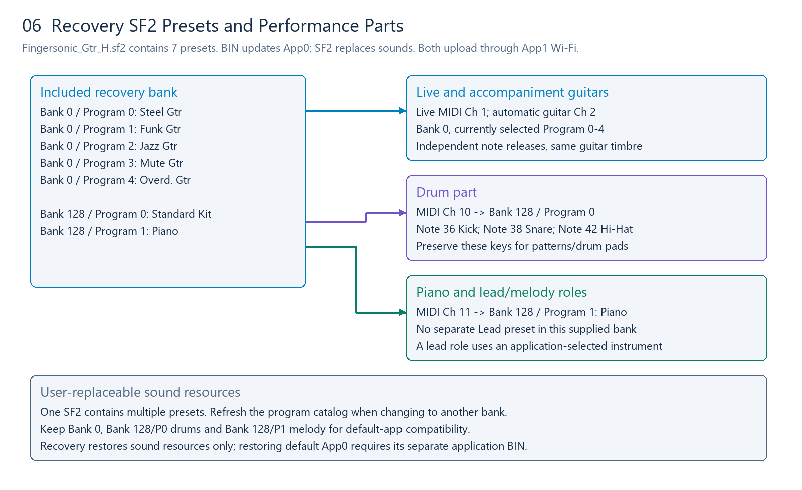

# SoundFont Layout, Replacement and Recovery

Version: 2.0 · Updated: 2026-10-13

SoundFont2 files contain samples, instrument zones and presets. App1 Wi-Fi can replace SF2 resources independently of App0 firmware. Uploading a new bank does not install a new application; installing an application does not automatically replace the bank. App1, the bootloader and partition table remain manufacturer-managed.

The package includes [Fingersonic_Gtr_H.sf2](../../recovery/Fingersonic_Gtr_H.sf2) for sound recovery. File size: **2,943,846 bytes**; SF2 version 2.1; seven presets; 61 sample headers. Its SHA-256 is:

```text
92ed846d71542271d238b326d92607a41aff142271d57c02d87dc88e222355b7
```

## 1. File, Bank, Program and Channel

| Term | Meaning |
|---|---|
| SF2 file | Sample/preset container; one file may contain many instruments |
| Bank | Preset bank number; not a MIDI channel |
| Program | Preset ID within a bank, normally 0–127; not the UI list position |
| Preset name | Display name; duplicates are possible |
| MIDI Channel | Message routing; each channel can select an instrument |
| Note/Velocity | Trigger inside the selected preset; drum keys may choose different drum pieces |

Identify a preset by `(Bank,Program)`. After replacing a file, refresh preset/name caches rather than assuming the old list or GM names still apply.

## 2. Exact presets in the supplied recovery bank



| Bank | Program, zero-based | Preset name | Purpose |
|---:|---:|---|---|
| 0 | 0 | Steel Gtr | Steel-string guitar |
| 0 | 1 | Funk Gtr | Funk guitar |
| 0 | 2 | Jazz Gtr | Jazz guitar |
| 0 | 3 | Mute Gtr | Muted guitar |
| 0 | 4 | Overd. Gtr | Overdriven guitar |
| 128 | 0 | Standard Kit | Drum kit |
| 128 | 1 | Piano | App piano/melody part |

These are the actual preset addresses in Fingersonic_Gtr_H.sf2, not inferred GM numbering. Replacement files may use different or nonconsecutive IDs. Request `FSGS1|PROGRAMS|GET` to obtain their actual Bank 0 catalog, then select with `FSGS1|SET|program=<ID>` or compatible Program Change.

For the supplied bank, the familiar guitar list is Steel/Funk/Jazz/Mute/Overdriven at Programs 0/1/2/3/4. Keep IDs/names stable when designing a compatible replacement. You can instead put synthesizer/bass/string presets in Bank 0 if you want a different instrument, and explain the changed list.

## 3. Default channel assignments

| Part | Human MIDI channel | Bank | Program |
|---|---:|---:|---|
| Live strings | 1 | 0 | Current selected guitar, 0–4 in recovery bank |
| Automatic guitar accompaniment | 2 | 0 | Same selected guitar |
| Drums | 10 | 128 | 0, Standard Kit |
| App piano/melody part | 11 | 128 | 1, Piano |

Separating Channels 1/2 lets live and accompaniment notes release independently while keeping their guitar timbre consistent. Channel 11 uses a melodic Piano preset in Bank 128; this is a product-specific allocation, not a rule that all Bank 128 programs are drum kits.

The default BLE input keeps drum/piano Bank/Program assignments fixed. External Bank Select/Program Change does not replace Channels 10/11 presets there; apps send notes on the corresponding channel. Third-party App0 may define a different route and should declare that difference.

Drum compatibility requires at least:

| MIDI Note | Piece | Default use |
|---:|---|---|
| 36 | Kick | Patterns and left Pitch pad E2 in drum mode |
| 38 | Snare | Patterns and right Pitch pad E5 in drum mode |
| 42 | Closed Hi-Hat | Pattern accompaniment |

Placing a kit at Bank 128/P0 does not automatically map its samples to these keys. Preserve the note assignments inside the replacement SF2.

## 4. Piano and Lead roles

The supplied H bank has **Piano at Bank 128/P1 and no separate preset named Lead**. A lead/melody role is an application role, not a separate DAC mode. It can use the selected guitar, Piano, or an instrument from a replacement bank.

Replacing the samples in Bank 128/P1 with a lead sound changes the instrument played by the default app's Channel 11 part. Adding a separate Lead preset is a different design: place it in Bank 0 if you want it selectable by the normal program list, or assign another Bank/Program/channel in your own App0.

```text
# Example for the supplied bank
Live guitar: Ch1, Bank0, Program0..4
Follow guitar: Ch2, Bank0, same selected Program
Drums: Ch10, Bank128, Program0 (Standard Kit)
Piano: Ch11, Bank128, Program1 (Piano)

# A separately added Lead needs its own published Bank/Program/channel map.
```

Do not assume a generic GM Lead number exists in this bank. List exact preset addresses with each replacement sound-bank release.

## 5. Designing a compatible replacement SF2

| Feature to preserve | Bank requirement |
|---|---|
| Local program selection | At least one usable Bank 0 preset, Program 0–127 |
| Five-guitar experience | Bank 0/P0–P4 with the corresponding guitar names/timbres |
| Patterns/drum pads | Bank 128/P0, including Notes 36/38/42 |
| App piano part | Bank 128/P1 with suitable melodic coverage |
| Program catalog | Readable names and actual IDs; nonconsecutive IDs are allowed |
| Your own engine | Your own preset/channel design, with compatibility declared |

Use standard uncompressed SF2 and a 16-bit sample-compatible path. SF3/compressed banks are a different format. Validate complex modulators, layered zones, large samples and unusual effects on the actual device; desktop playback is not sufficient proof of embedded compatibility.

Choose sensible root keys, key/velocity ranges, loop points and envelopes. Drum keys should select their intended samples; melodic instruments should cover the required range. Leave mixing headroom instead of making every sample full-scale. Distribute only sounds you are authorized to distribute.

## 6. Storage and memory limits

The 2 MiB App0 limit applies to application BINs, not SF2. Sound-bank limits depend on free LittleFS space and runtime PSRAM. The filesystem region is about 10.94 MiB and also holds settings/staging files; loading samples requires additional memory.

A bank smaller than 10.94 MiB is therefore not guaranteed to load. Test a small bank first, then check available PSRAM, polyphony, fast program changes and sustained playback. The supplied recovery file is about 2.81 MiB, separate from the App0 image budget.

The default device uses one active SF2 resource bank. A new SF2 replaces the old file; it does not add a user-selectable collection of separate SF2 files. Multiple presets inside one SF2 are a different form of instrument selection.

## 7. Upload and restore

Use [FingersonicUploader](https://fingersonic.net/blogs/apps/fingersonicuploader-upload-custom-sounds-to-your-fingersonic) on Windows/macOS. The page provides Windows and macOS ARM downloads.

1. Keep the bundled recovery bank and any custom bank you want to restore later.
2. Enter the existing App1 uploader and join **Fingersonic**, password **88888888**.
3. Select your `.sf2`, upload and wait for restart.
4. Check Bank 0 programs, drum Notes 36/38/42 and the Channel 11 piano part.

Uploading SF2 removes old SF2 resources to free space. Other settings/custom-chord files are normally kept. An interrupted upload may leave the old bank unavailable; upload a valid bank again.

To return to official firmware and sounds, use the [official recovery tool](http://update.fingersonic.cn/FingersonicGuitarUploader/) and follow the [recovery instructions](../../recovery/README.md#return-to-the-official-instrument). Prepare each file on your normal Internet connection before joining the device hotspot. Official App0 and SF2 are separate uploads. main2 is a developer reference/test example, not official product firmware.

The included [recovery/Fingersonic_Gtr_H.sf2](../../recovery/Fingersonic_Gtr_H.sf2) provides offline sound-resource recovery only; official App0 restoration is a separate operation.

## 8. Linux and custom upload clients

Join the same App1 hotspot and use the public HTTP interface:

```bash
# Firmware: App0 application BIN only, <=2MiB
curl --fail -F 'file=@./MyFirmware.bin' http://192.168.4.1/upload

# Custom sound bank
curl --fail -F 'file=@./MySoundBank.sf2' http://192.168.4.1/upload

# Bundled recovery sound bank, from the package root
curl --fail -F 'file=@./recovery/Fingersonic_Gtr_H.sf2' http://192.168.4.1/upload
```

Use multipart/form-data with field `file` and preserve the BIN/SF2 extension. Check the HTTP result, report failures, wait for restart and help users reconnect their normal network. A custom uploader should offer separate App0 firmware and SF2 resource targets, with no system-image operations.

## 9. Replacement-bank validation

- Bank 0 presets/names appear and actual Program IDs match the app catalog.
- Channel 10 uses Bank 128/P0 and drum Notes 36/38/42 sound correctly.
- Channel 11 uses Bank 128/P1; melodic range and Note Off work.
- Any additional Lead has a documented actual Bank/Program/channel.
- Strong velocities/polyphony do not clip; looping samples stop when released.
- The recovery SF2 is available for restoring sound resources over Wi-Fi.
