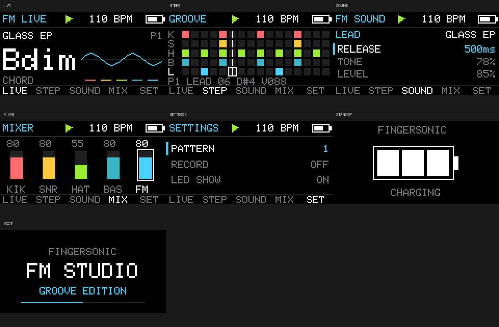

# Fingersonic FM Studio — main2 Reference/Test Example

**For developer reference and testing only. main2 is not official Fingersonic Guitar firmware and is not an official recovery image.** It demonstrates how to build an App0 application using the published hardware interfaces.

An open-source App0 reference application for Fingersonic Guitar: a playable FM synthesizer, five-track groovebox and on-device sound editor. Use it to learn the hardware interfaces or build your own instrument.

This is a complete Arduino sketch. Open **main2.ino** with its accompanying files, or build the directory with Arduino CLI. The source is self-contained apart from the public libraries listed below. Audio is generated in software; this example does not load SF2 files or mount LittleFS. Its settings use the dedicated NVS namespace `fsg-fm`.



Host-rendered views from the same UI layout functions used by the firmware.

## Features

- 32 kHz, 16-bit stereo I2S; both channels carry the same mix. Eight FM voices plus synthesized Kick, Snare and Hi-Hat.
- Eight presets: Glass EP, Round Bass, Pluck, Bell, Soft Organ, Marimba, FM Brass and Space.
- Independent Bass and Lead patches, with ratio 0.25–8, FM index 0–5, ADSR, Tone and Level controls.
- Five tracks: Kick, Snare, Hat, Bass and Lead; 16 steps per pattern and four pattern banks. Default tempo 110 BPM, adjustable 30–300 BPM; Swing 0–60%.
- Pattern changes during playback take effect at the next bar. Each melodic track records one note per sixteenth-note step; a later note replaces an earlier note in the same step.
- Six touch strings sound on release. Short adjacent-string contacts retain velocity compensation. Touching all six strings stops playback and mutes sound; release every string before playing again.
- LIVE joystick directions N/NE/E/SE/S/SW/W/NW select C/Dm/Em/F/G/Am/Bdim/G7. Center uses the open E-A-D-G-B-E notes.
- Encoder, joystick, TFT, battery/charging status, two dual-electrode pad groups and an asynchronous LED ring are demonstrated together.

Standard USB/BLE MIDI, the optional Fingersonic App protocol, Follow and Loop are extension ideas for your own version. This example currently provides local operation.

## Controls

The physical orientation is **upright front view, logo at the top**. Electrode numbers are MPR121 channels, not ESP32 GPIOs.

| Touch control | Electrode | FM Studio action |
|---|---:|---|
| Left lower pad, physically Tempo | E9 | Kick |
| Right lower pad, physically Meter | E8 | Snare |
| Left upper Pitch/Down pad | E2 | Hold for −2 semitones |
| Right upper Pitch/Up pad | E5 | Hold for +2 semitones |
| Strings 6→1 | E1/E0/E3/E4/E6/E7 | Prepare on press, sound on release |

Both Pitch pads held together give a centered bend. FM Studio uses individual pad holds rather than the default instrument's two-pad sweep gesture. It initializes all electrodes with touch/release thresholds 7/7.

| Page/control | Action |
|---|---|
| Short encoder press | LIVE → STEP → SOUND → MIX → LIVE |
| Hold encoder for 1 second | Enter/leave SETTINGS; a short press in SETTINGS also exits |
| Hold joystick switch for 1 second | Start/stop playback from any page; release does not also trigger a click |
| LIVE: turn encoder | Select Lead preset |
| LIVE: hold joystick switch + turn encoder | Adjust tempo; release does not toggle recording |
| LIVE: short joystick click | Toggle quantized recording; enabling recording starts playback |
| STEP: joystick left/right or encoder | Select step; outline is edit position, white line is playback position |
| STEP: joystick up/down | Select track |
| STEP: short joystick click | Enable/disable step |
| STEP: hold joystick switch + turn encoder | Edit drum velocity or Bass/Lead pitch |
| SOUND: joystick up/down | Select FM parameter |
| SOUND: joystick left/right | Select Bass or Lead |
| SOUND: hold joystick switch + turn encoder | Select the current part's preset |
| SOUND: encoder / joystick click | Edit parameter / audition the current patch |
| MIX: joystick directions | Select track |
| MIX: encoder / joystick click | Set level / toggle mute |
| SETTINGS: joystick up/down | Select option |
| SETTINGS: encoder or joystick left/right | Edit Tempo, Swing, Master, Echo, Pattern, Record or LED |
| SETTINGS: SAVE/LOAD + joystick click | Save/load song and patches |
| SETTINGS: CLEAR/DEFAULTS/UPLOADER | Click to show CONFIRM, click again to act; moving or turning cancels |

SAVE stores all four patterns, both patches and system parameters. LOAD restores them. The audio task acknowledges a pause before Flash access. DEFAULTS clears only this example's NVS settings. UPLOADER selects the existing App1.

## Hardware

| Interface | GPIOs |
|---|---|
| TFT SCLK/MOSI/CS/DC/RESET/backlight | 13/14/10/18/21/9 |
| I2S BCLK/DOUT/WS | 40/41/42 |
| MPR121 SDA/SCL | 11/12 |
| Encoder A/B/SW | 38/39/47 |
| Joystick X/Y/SW | 6/5/7 |
| LED ring | 48 |
| Battery ADC / CHRG / STDBY / power state | 1/2/4/8 |

The display is ST7735S, landscape 160×80, rotation 3, offsets 24/0, BGR and no inversion. Read the [hardware guide](../../FIRMWARE_DEVELOPMENT_GUIDE.md) before changing pins.

FM Studio shows its logo for 5 seconds. GPIO8 at or above 2.6 V for 100 ms enables full operation. Once audio initialization completes, GPIO8 below 2.4 V for 500 ms returns to silent standby without repeatedly restarting. These are this example's hysteresis settings; they differ from the default instrument's shutdown policy.

Charging inputs follow the board logic: CHRG/STDBY 1/0 is charging; 0/1 is full only after the appropriate voltage endpoint is reached. Display curves are 3.62–4.15 V for running/charging, 3.17–3.85 V for not charging and 3.67–4.21 V for standby/charging. Sampling is once per second, with 30-sample averaging and a maximum display change of 3 percentage points. The initial estimate uses four readings after the first second.

Only the input task accesses ADCs. A failed touch-controller initialization displays TOUCH! while leaving the encoder/joystick sequencer usable.

## Dependencies and build

Reproduction baseline: Arduino ESP32 Core **3.3.2**, ESP32S3 Dev Module, 240 MHz CPU, 16 MB Flash, OPI PSRAM and the supplied custom partitions.csv. These instructions build an App0 application for existing Fingersonic hardware.

| Library | Version |
|---|---|
| Adafruit MPR121 | 1.1.3 |
| Adafruit BusIO | 1.17.4 |
| Adafruit GFX Library | 1.12.6 |
| Adafruit ST7735 and ST7789 Library | 1.11.0 |
| DaisySP subset | Included in src/DaisySP; MIT |

Install Arduino CLI and put it on PATH. From the repository root:

```sh
arduino-cli core update-index --additional-urls https://espressif.github.io/arduino-esp32/package_esp32_index.json
arduino-cli core install esp32:esp32@3.3.2 --additional-urls https://espressif.github.io/arduino-esp32/package_esp32_index.json
arduino-cli lib install "Adafruit MPR121@1.1.3" "Adafruit BusIO@1.17.4" "Adafruit GFX Library@1.12.6" "Adafruit ST7735 and ST7789 Library@1.11.0"
cd examples/main2
```

Windows PowerShell:

```powershell
./build.ps1
# If Arduino CLI is not on PATH:
./build.ps1 -Cli 'C:\Tools\arduino-cli.exe'
```

Linux/macOS, or any shell with Arduino CLI:

```sh
arduino-cli compile --fqbn 'esp32:esp32:esp32s3:USBMode=default,CDCOnBoot=cdc,CPUFreq=240,FlashMode=qio,FlashSize=16M,PartitionScheme=custom,DebugLevel=none,PSRAM=opi,LoopCore=1,EventsCore=1' --build-path './build' .
```

The application is **build/main2.ino.bin**, and must be at most **2, 097, 152 bytes**. The PowerShell script checks this limit and prints its SHA-256. In Arduino IDE, open main2.ino, use the same board settings and export the application binary.

## Wi-Fi upload and recovery

User firmware replaces **App0 only** through the preinstalled App1 Wi-Fi uploader. Preserve App1, the manufacturer bootloader, partition layout and filesystem resources.

1. Enter SETTINGS → UPLOADER and confirm. Recovery also works by holding the encoder during a true cold start with charging disconnected.
2. Join **Fingersonic**, password **88888888**.
3. Upload **main2.ino.bin** with [FingersonicUploader](https://fingersonic.net/blogs/apps/fingersonicuploader-upload-custom-sounds-to-your-fingersonic) on Windows/macOS, or use the HTTP interface.
4. Wait for the upload and restart. Normal operation uses the FM Studio controls above.

```sh
curl --fail -F 'file=@./build/main2.ino.bin' http://192.168.4.1/upload
```

To return to the official Fingersonic Guitar experience, use the [official firmware and sound-bank recovery tool](http://update.fingersonic.cn/FingersonicGuitarUploader/). Prepare the official file while connected to the Internet, then enter App1 and join its hotspot to upload it. Follow the [complete recovery steps](../../recovery/README.md#return-to-the-official-instrument).

Official App0 restores the instrument behavior. The official SF2 can be restored separately if you replaced its sounds. FM Studio leaves the existing SF2 in place, so returning from main2 normally needs only official App0. **The main2 application BIN is for testing this example; use the official recovery tool when restoring the official instrument.**

## Code structure

| File | Responsibility |
|---|---|
| main2.ino | Arduino entry point |
| config.h | Hardware mapping, sample rate and DMA sizes |
| GrooveCore.* | FM voices, drums, sequencer, effects and command application |
| GrooveRuntime.* | Inputs, power, task communication, NVS and App1 entry |
| GrooveDisplay.cpp | Real firmware UI and dirty-region display transfers |
| RingLedOutput.* | Asynchronous RMT DMA output and frame ownership |
| src/DaisySP | Bundled DSP subset and retained MIT notices |
| tests | DSP regressions and rendering of the actual UI layout functions |

The audio task owns mutable engine state. Input sends bounded queued commands and publishes memory-only view snapshots. The display renders those snapshots. NVS operations pause audio before accessing Flash.

| Task | Core | Priority | Stack |
|---|---:|---:|---:|
| fm_audio | 0 | 10 | 6, 144 bytes |
| fm_input | 1 | 4 | 6, 144 bytes |
| fm_display | 1 | 1 | 4, 096 bytes |

Audio uses 128-frame blocks and four 128-frame DMA buffers. Display compares eight-row strips, at about 25 FPS for editing and 15 FPS for LIVE/standby. LEDs update at most 20 FPS. `underruns` counts render-budget overruns and I2S errors, not a measured hardware DMA underrun counter; `cpuPercent` measures render-budget occupancy.

## Optional host tests

Firmware building needs only Arduino CLI/Core/libraries. Host tests additionally require Python, Pillow, an installed Adafruit GFX library and a native C++ compiler. Run from examples/main2:

```sh
python -m pip install -r tests/requirements.txt
python tests/test.py --compiler c++ --gfx '/path/to/Arduino/libraries/Adafruit_GFX_Library'
```

`CXX` and `ADAFRUIT_GFX_DIR` can supply those paths. The native runner supports GCC/Clang shared libraries on Linux/macOS and a configured Windows native toolchain. For Windows ESP LLVM without a full native SDK, use its minimal CRT wrapper:

```powershell
./tests/test.ps1 -LlvmBin 'C:\Toolchains\esp-clang\bin' -Gfx 'C:\Arduino\libraries\Adafruit_GFX_Library' -Python python
```

Tests execute the same synthesis and layout code as the firmware. They cover all eight presets, eight-voice mixing, release, limiting, the sine table, tempo/swing, pattern switching and recording. They generate a demo WAV, seven page previews and startup-diagnostic checks under ignored build/. If a firmware build exists there, its App0 size and App0/App1 partition entries are checked too.

Host results do not measure ESP32 performance. Verify joystick direction, ADC thresholds, encoder behavior, touch response, power transitions, volume and sustained audio on your actual hardware.

The public example was compiled on 2026-10-13 with ESP32 Core 3.3.2: its application BIN was 463840 bytes, within the 2 MiB App0 limit. The Windows ESP LLVM host regressions, seven UI views and startup diagnostics passed. Linux/macOS instructions are provided, but those host toolchains were not run for this release.

## License and contact

Fingersonic-authored source is released under [Apache License 2.0](LICENSE). The bundled DaisySP subset remains MIT; retain [its license](src/DaisySP/LICENSE), [NOTICE](NOTICE.md) and [third-party information](THIRD_PARTY.md) when redistributing.

- Website: [Fingersonic.net](https://fingersonic.net/)
- Support: [support@fingersonic.net](mailto:support@fingersonic.net)
