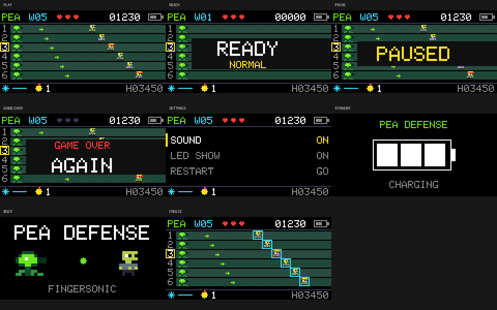

# Pea Defense

**Experimental App0 reference/test application; not official Fingersonic Guitar firmware or an official recovery image.**

A six-lane pixel defense game played directly on Fingersonic Guitar's six touch strings. Instead of playing notes, tap a string to fire a pea down its matching lane and keep approaching enemies away from your plants.

GAMEPLAY
- Six independent lanes, with physical strings 1-6 shown from top to bottom on the display. Fire on touch; release and tap again for another shot. Holding a string does not auto-fire.
- All six lanes can fire together, with a separate 140 ms cooldown per lane. This game does not use the instrument's all-six-strings mute gesture.
- Three lives, rising waves, scores and short-window combo bonuses.
- Walkers, faster runners and three-hit helmet enemies. Helmet enemies appear from wave 3; runners from wave 4.
- Freeze slows enemies to one quarter speed for 2.5 seconds, with an 8-second cooldown. Bombs clear the current enemies; completing a wave replenishes one bomb, up to three.
- EASY, NORMAL and HARD difficulties, with separate saved high scores. Difficulty changes during a paused game apply to the next run.
- Synthesized effects for shots, hits, kills, breaches, freeze, bombs, waves and game over. Sound and LED effects can each be switched off.
- Independent fsg-main3 NVS settings. The existing SF2 bank, custom chords and original settings files are left in place.

This is an experimental community App0 game, not official Fingersonic Guitar firmware or an official recovery image. The images are host-rendered views from the game's actual drawing code. No SF2 or other audio assets are needed. The complete standalone Arduino source is included here.




## Controls, installation and recovery

PEA DEFENSE CONTROLS
- Touch physical strings 1-6 to fire into display lanes 1-6, ordered top to bottom. Touching a string in READY starts the game and fires; after GAME OVER it restarts and fires.
- Facing the instrument upright, logo at the top: the right lower Meter pad activates freeze; the left lower Tempo pad triggers a bomb. The right upper Up pad selects the previous lane; the left upper Down pad selects the next lane.
- Joystick up/down, or the encoder during play: select a backup firing lane, marked by the yellow frame. Click the joystick to fire into the selected lane; while paused it resumes play.
- Short encoder press: start from READY/GAME OVER, or pause/resume during a game.
- Hold the joystick switch for about 0.9 seconds: pause/resume. Hold the encoder for about 0.9 seconds: open/close SETTINGS, pausing the game while the menu is open.
- In READY, turn the encoder or move the joystick left/right to change difficulty.
- In SETTINGS, use joystick up/down to select Difficulty, Sound, LED Show, Restart or Uploader. Turn the encoder or use joystick left/right to adjust an option. Click the joystick to toggle/execute; RESTART and UPLOADER need a second click to confirm. Short-press the encoder to leave the menu.
- The snowflake/blue line shows freeze availability/cooldown; the yellow bomb number shows bombs remaining; H is the high score for the selected difficulty.

Compatibility: Fingersonic Guitar with the existing ESP32-S3 board, 16 MB Flash, OPI PSRAM, ST7735S display and original manufacturer partition layout. This is an experimental community App0 application, not official Fingersonic Guitar firmware or an official recovery image.

WI-FI INSTALLATION
1. Download the application BIN while connected to the Internet. Save any work in your current application first.
2. Enter the preinstalled App1 uploader. From FM Studio or Pea Defense, hold the encoder to open SETTINGS, select UPLOADER with the joystick and confirm twice with the joystick switch. For the original cold-start recovery entry, disconnect charging and fully remove power, then hold the encoder while powering on for at least about 0.5 seconds. A GPIO8 soft-off alone is not a true cold start.
3. Connect your computer to the Fingersonic Wi-Fi hotspot, password 88888888.
4. On Windows or macOS, use FingersonicUploader: https://fingersonic.net/blogs/apps/fingersonicuploader-upload-custom-sounds-to-your-fingersonic
   Select only the application BIN supplied with this release. Linux users can use the documented App1 HTTP upload interface:
   curl --fail -F 'file=@main3.ino.bin' http://192.168.4.1/upload
5. Wait for completion and the automatic restart. Replace App0 only; preserve App1, the manufacturer bootloader, the partition layout and filesystem resources.

RETURN TO THE OFFICIAL INSTRUMENT
Use the official firmware and sound-bank recovery tool: http://update.fingersonic.cn/FingersonicGuitarUploader/
Prepare the official App0 file while connected to the Internet, then enter App1 and join the Fingersonic hotspot to upload it. Official App0 and the official SF2 bank are separate uploads. These two community applications generate their own sound and leave the existing SF2 bank in place, so returning normally needs only official App0. Re-enter App1 for a separate SF2 restoration if you changed that bank independently.

VALIDATION AND LIMITATIONS
The supplied App0 was built with Arduino ESP32 Core 3.3.2. Host regressions execute the actual application logic and drawing code; all included screenshots are host-rendered firmware UI, not photographs or evidence of on-device testing. The host checks passed again on 2026-10-19. Touch response, joystick direction, power transitions and sound still require verification on your own hardware. No SF2 file is required. No Fingersonic App integration or automatic GitHub release synchronization is enabled for these releases.

Website: https://fingersonic.net/
Support: support@fingersonic.net

## Build the application

Baseline: Arduino ESP32 Core 3.3.2, ESP32S3 Dev Module, 240 MHz, 16 MB Flash and OPI PSRAM, using the supplied custom partition layout. Install Adafruit MPR121 1.1.3, Adafruit BusIO 1.17.4, Adafruit GFX Library 1.12.6 and Adafruit ST7735 and ST7789 Library 1.11.0. See the [dependency guide](../../docs/developer/DEPENDENCIES.md).

From the repository root, with Arduino CLI installed:

```sh
cd examples/main3
arduino-cli compile --fqbn 'esp32:esp32:esp32s3:USBMode=default,CDCOnBoot=cdc,CPUFreq=240,FlashMode=qio,FlashSize=16M,PartitionScheme=custom,DebugLevel=none,PSRAM=opi,LoopCore=1,EventsCore=1' --build-path './build' .
```

On Windows, `./build.ps1` performs the same compilation, checks the App0 size and prints its SHA-256. If Arduino CLI is not on PATH, pass `-Cli` with its executable path. Upload only `build/main3.ino.bin` through App1 Wi-Fi. The partition CSV is for compiling App0; system images are not user update targets.

## Code structure

| File | Responsibility |
|---|---|
| main3.ino | Arduino entry point |
| config.h | Existing board mapping and game lane order |
| GameCore.* | Fixed-step simulation, fixed object pools, collisions, scoring and waves |
| GameRuntime.* | Inputs, power, NVS settings, task snapshots and App1 entry |
| GameDisplay.cpp / GameSprites.h | Display layout, pixel sprites and changed-strip transfers |
| GameSound.* | Four-voice synthesized sound effects and I2S output |
| RingLedOutput.* | Asynchronous RMT DMA LED output |
| tests | Game/audio regressions and the actual firmware UI rendering |

The game maps lanes 1-6 to physical strings 1-6 from top to bottom. Their MPR121 electrodes are E7/E6/E4/E3/E0/E1. Freeze is right lower E8, bomb is left lower E9, previous lane is right upper E5 and next lane is left upper E2. These are touch-controller channels, not ESP32 GPIOs. Read the [hardware guide](../../FIRMWARE_DEVELOPMENT_GUIDE.md) before changing wiring.

## Optional host checks

The bundled host runner targets Windows with ESP LLVM and Python/Pillow. Firmware compilation itself is independent of this host runner.

```powershell
python -m pip install -r tests/requirements.txt
./tests/test.ps1 -LLVM 'C:\Toolchains\esp-clang\bin' -Gfx 'C:\Arduino\libraries\Adafruit_GFX_Library' -Python python
```

`ESP_LLVM_BIN` and `ADAFRUIT_GFX_DIR` can supply those locations. The tests cover simultaneous six-lane shots, cooldown, collision ordering, helmet health, freeze, bombs, pause, misses, restart, capacity, waves, sustained simulation and sound output. They render eight real UI scenes, check that the running game moves while a paused game remains still, and validate App0/App1 sizes when a firmware build is present. Generated files stay under ignored `build/`.

Simulation and UI host checks do not establish performance or touch response on hardware. Verify your instrument before relying on a modified release.

## License

Copyright 2026 Fingersonic. Source, original pixel sprites and tests are published under [Apache License 2.0](LICENSE); retain the [notice](NOTICE.md). Dependencies installed separately retain their own licenses.
